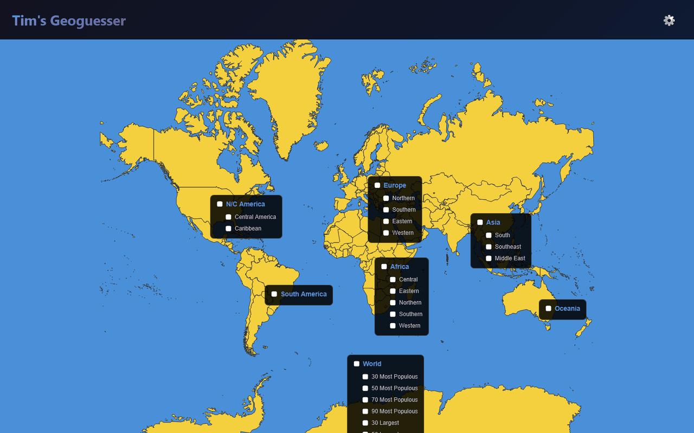
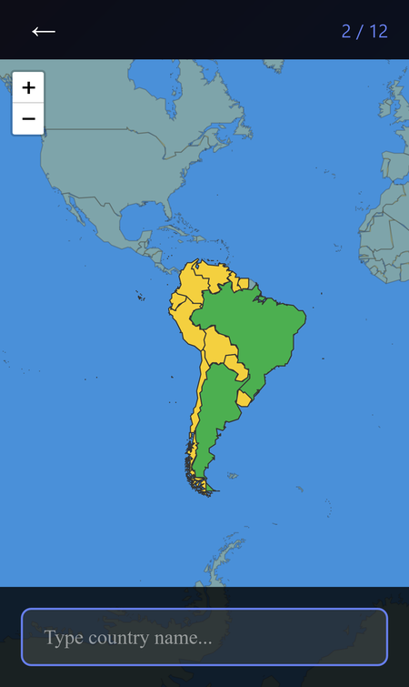
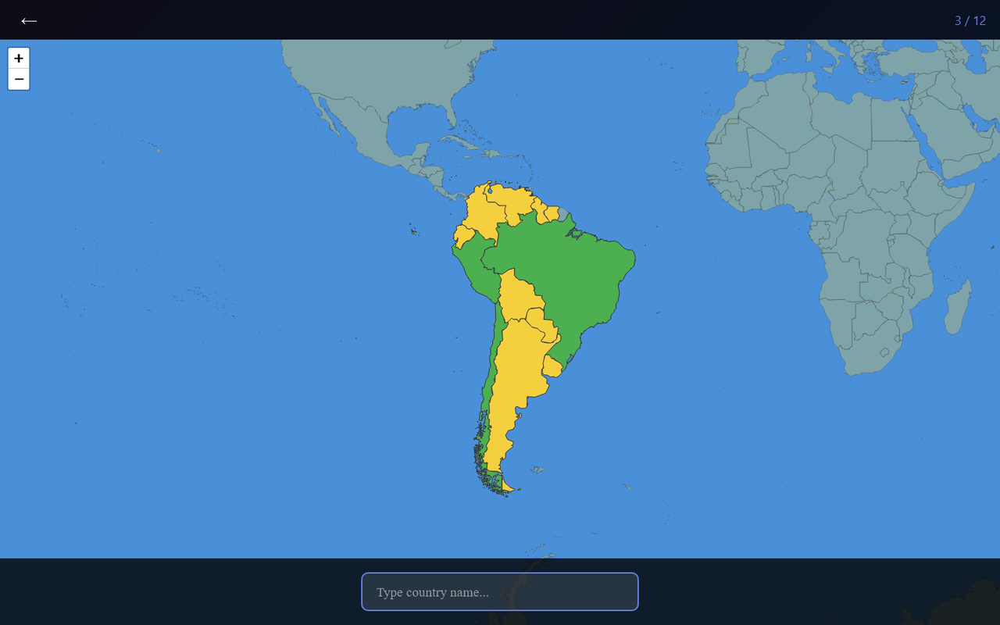

# Tim's Geoguesser

A map quiz for learning the world's countries: pick regions on a world map, then name every country or find each one on the map.

**[▶ Open the live app](https://timothyhadfield.github.io/map-memorization/)** · works on phone and laptop

  
  &nbsp;
  

  

## Features
- **Pick your regions** — check whole continents or sub-regions (Northern Europe, West Africa, the Caribbean, the Middle East…) right on the map.
- **World lists** — 30 to 90 most populous or largest countries, or the 32 smallest.
- **Two quiz types** — *Type In* (name every highlighted country; guessed ones turn green) or *Spot on Map* (tap the country that's asked for).
- **Tiny countries stay findable** — microstates and small islands get a circle so you can tap them.
- **Results screen** — accuracy, time, and lists of what you got right and wrong, with one-tap retry.
- **Settings** — timed mode (10 seconds per country), accept common aliases or require exact spelling, read names aloud, show dots on countries you haven't named yet.

## Built with
A single HTML page with plain JavaScript and Leaflet; country outlines come from the open [geo-countries](https://github.com/datasets/geo-countries) dataset.
